> **Super Mario 64 is a [NumPlay](../../README.md) game that comes on its own.** It is too big to sit next to NumPlay. Get `SuperMario64.nwa` from the [latest release](https://github.com/Mason363/NumPlay/releases/latest).

  

<h1 align="center">Super Mario 64</h1>

  <b>Mario's first adventure in 3D, on the NumWorks calculator.</b> 
  Nintendo's Super Mario 64, run by the game's own code: Peach's castle and its first five courses, with their stars.

  <a href="https://github.com/Mason363/NumPlay/releases/latest/download/SuperMario64.nwa"><b>Download SuperMario64.nwa</b></a>
  &nbsp;·&nbsp; <a href="#controls">Controls</a>

  

## Highlights

* **The real game:** not a lookalike, but Super Mario 64's own code, from the [n64decomp/sm64](https://github.com/n64decomp/sm64) decompilation, built for the calculator. Mario runs, jumps and falls exactly as on the Nintendo 64, the enemies think as they did, Lakitu films it all, and the dialogs, the HUD, the pause menu and the transitions are the game's.
* **Mario's whole moveset:** walk, run, crouch and crawl; the double and triple jump, the backflip, the side somersault, the long jump and the wall kick; punches, kicks, the dive, the slide kick and the ground pound; climbing poles and trees, hanging from ledges and fences, swimming, carrying and throwing.
* **Peach's castle:** her letter, Lakitu's flight over the grounds and the warp pipe; the grounds with the moat, the bridge and the trees; the courtyard and its Boos; the castle's first floor with its lobby, its star doors (1, 3 and 8 stars), its paintings and the doors that open with stars.
* **Five courses and their stars:** Bob-omb Battlefield, Whomp's Fortress, Jolly Roger Bay, Cool, Cool Mountain and Big Boo's Haunt: their six missions each and the 100-coin stars, 33 of their 35 stars to get (Mario Wings to the Sky and Eye to Eye in the Secret Room need the Wing Cap and the Vanish Cap, whose switches are in levels left out), with the act select, King Bob-omb, Koopa the Quick, the Whomp King, the sunken ship and its eel, the penguins and their race, the Big Boo and the mad piano.
* **In 3D, as on the N64:** the levels, models and animations are the game's, drawn by NumPlay's renderer with perspective-correct textures, the game's fog and lights, and shadows; the game thinks 30 times a second, as on the N64.
* **Saved like on the cartridge:** collect a star and it's saved, as the N64's save chip did. Your stars are also copied into `sm64_saves.py`, so installing the app again doesn't erase them.

<table>
  <tr>
    <td align="center">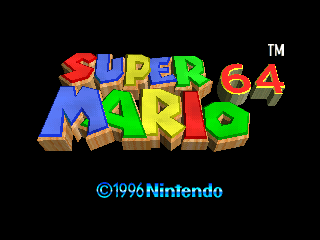 The title</td>
    <td align="center">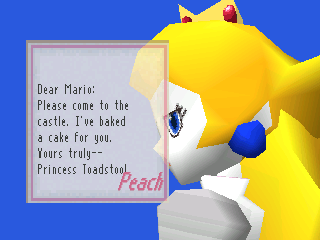 Dear Mario: Peach's letter</td>
  </tr>
  <tr>
    <td align="center">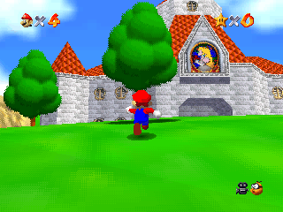 Peach's castle</td>
    <td align="center">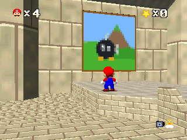 The way into Bob-omb Battlefield</td>
  </tr>
  <tr>
    <td align="center">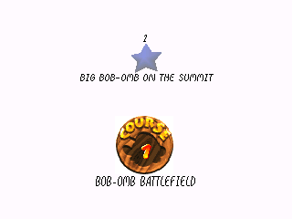 Choosing a star</td>
    <td align="center">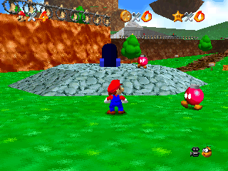 Bob-omb Battlefield</td>
  </tr>
  <tr>
    <td align="center">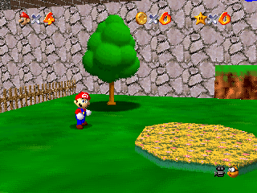 Whomp's Fortress</td>
    <td align="center">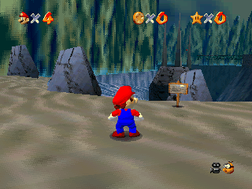 Jolly Roger Bay</td>
  </tr>
  <tr>
    <td align="center">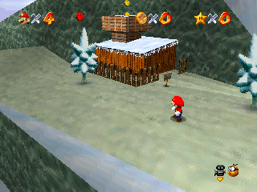 Cool, Cool Mountain</td>
    <td align="center">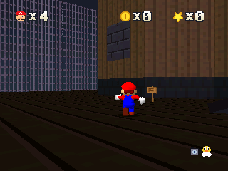 Big Boo's Haunt</td>
  </tr>
  <tr>
    <td align="center">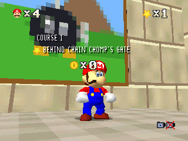 A star got</td>
    <td align="center">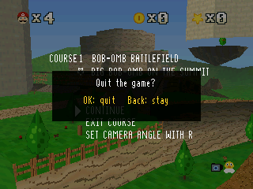 The pause menu</td>
  </tr>
</table>

## How to play

Press Start (⌫) or OK on the title: the first time, the keys come first, then Peach's letter. Get into the castle and jump into a painting to enter its course, choose a star to go for, and get it. Stars open the castle's star doors. Lakitu films you: turn him around with 4 and 6, and bring him closer or further with 8 and 2. ⌫ pauses: in a course, the pause menu can take you back to the castle, and Shift quits the game (it asks first).

## Controls

| Key | What it does |
| --- | --- |
| Arrows | Move (the control stick) |
| alpha (held) | Walk and tiptoe instead of running |
| OK or EXE | A: jump, swim, read signs and talk |
| Back | B: punch, kick, dive, pick up and throw |
| shift | Z: crouch, slide, ground pound (with jumps: long jump, backflip) |
| 4 / 6 | Turn the camera left / right (C◀ / C▶) |
| 8 / 2 | Camera closer / further (C▲ / C▼) |
| 0 | R: Mario's camera or Lakitu's |
| ⌫ | Start: pause |
| Home | Quit (the stars are saved as you get them) |

The title shows these keys with Shift, and a new game starts with them.

## Good to know

* **Five courses of fifteen:** the app space holds the castle's grounds, courtyard and first floor and the five courses whose doors are there. The basement and the floors above, behind Bowser's two keys, don't fit: neither do Bowser's courses and fights, the secret levels (the Princess's Secret Slide, the Tower of the Wing Cap, the Secret Aquarium and the cap levels), Lethal Lava Land and the courses after it. Their ways in do nothing: the slide's hole and the aquarium's wall take you nowhere, nor does the sunlight in the lobby, and the trapdoor behind the 8-star door stays shut.
* **One save file:** the N64 had four; here it is file A. Collecting a star saves, as in the game, and Home quits (what you did since the last star is lost, as when you switched an N64 off).
* **No sound:** the calculator has no speaker.
* **The pictures are painted:** the game's pictures are in its ROM, which isn't public: see below.
* **Fewer things at once:** the N64 kept up to 240 objects moving; the calculator's RAM has room for about 147. In the busiest places, a bubble or a sparkle may not appear.
* **On the N0110 and N0115** (216 MHz, the N0120 has 550), the game draws at half the resolution to keep its pace.

## How it's made

The game's code is the n64decomp team's decompilation of Super Mario 64: thousands of functions rewritten in C that compile to the same game. It runs on the calculator almost unchanged (its few changes are marked `(calculator)`); the N64's graphics chip, its memory and its cartridge are what the port (`src/port`) replaces.

The calculator gives an app about 130 KB of RAM, and the N64 had 4 MB. So the levels, models, animations and collision never come to RAM: `tools/pack.py` and `tools/port.py` turn the decompilation's data into the calculator's own formats, read in place from flash: meshes with 4-bit textures, collision surfaces sorted into the game's cells ahead of time, animations kept one byte a key frame. The game's display lists for the HUD, the dialogs and the menus are played by `src/port/gfx.c`, and the 3D is drawn by NumPlay's renderer (`src/render.c`) ten rows at a time, with no frame buffer.

`make` builds `output/sm64.nwa` (needs `arm-none-eabi-gcc` and Node.js for nwlink). `make host` builds the game for a computer, `make test` plays it there with the sanitizers on (`tests/check.py`), and `make media` takes the pictures on this page. `python3 tools/fetch.py build/ref` downloads the decompilation and `make data REF=build/ref/decomp` makes the game's data again (`src/data.bin` and `src/port/gen`).

### The pictures

The decompilation has the game's code, models, levels, animations and text, but not its pictures, which are in the ROM. Every texture here is painted for the calculator, after the game's:

* **Drawn by hand, after the game:** Mario (his face, eyes, emblem and buttons), coins, stars, hearts and the boxes; Goombas, Bob-ombs, the Chain Chomp, Koopas, Whomps, Boos, Lakitu, Peach and Toad, and the other characters; the trees, doors, signs and pipes; the HUD, its fonts and the dialogs' font, the power meter, Peach's letter (`tools/art.py`, `tools/glyphs.py`); the castle's walls, roofs, windows, lawns and paving, Peach's stained-glass window, the lobby's red carpet and the four paintings (`tools/scenery.py`); Bob-omb Battlefield's grass, rock, paths and fences (`tools/textures.py`).
* **Painted from where they are used:** the other walls and floors of the courses, and a few small actors, are painted by `tools/textures.py` from where each texture lies (floor, wall or ceiling), its level's colours and the vertex colours it is drawn with: they look like the right material (snow, wood, stone, sand) but are not the game's exact pictures.

## Credits

Super Mario 64 is Nintendo's game (1996). Not affiliated with Nintendo.

* **[n64decomp/sm64](https://github.com/n64decomp/sm64)**, the decompilation of Super Mario 64 by the n64decomp team: the game's code and data in `decomp/`, and the data `tools/pack.py` and `tools/port.py` read.

Made by Mason Chen as part of NumPlay.

## License

NumPlay's own code here (the port in `src/`, the renderer, the tools in `tools/` and the tests) is licensed under the GNU General Public License v3.0: see the `LICENSE` file at the root of the repository.

The code and data in `decomp/` come from the [n64decomp/sm64](https://github.com/n64decomp/sm64) project, and so do the models, levels, animations and text packed into `src/data.bin` and `src/port/gen/`. They are not covered by NumPlay's GPL: the n64decomp team placed their work under CC0 (`decomp/LICENSE.md`), but what they decompiled is Nintendo's game, and it stays Nintendo's.
